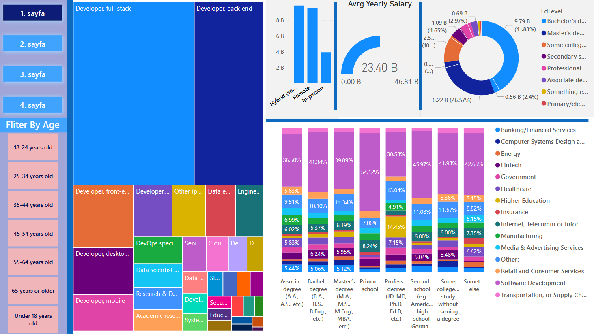

# Stack Overflow 2023 Survey — Power BI & Streamlit Visualization & Prediction Model
## _(For **Streamlit project** please seek streamlit folder in this repo)_

This repository contains a Streamlit app also a Power BI project and an accompanying prediction model built from the Stack Overflow Developer Survey 2024 data. The Streamlit app (see the streamlit folder) provides interactive visualizations; the repo also includes the Power BI report file (ProjeST.pbix), an exported Power BI PDF (ProjeST.pdf), a project report PDF, and a Jupyter notebook (PredictionModel.ipynb) with the prediction model and experiments.

## Files of interest
- **`streamlit folder`** - Includes all files and app.py related to streamlit project.
- `ProjeST.pbix` — Power BI report (Power BI Desktop file).
- `ProjeST.pdf` — Exported PDF of the Power BI report (embedded below).
- `PredictionModel.ipynb` — Jupyter notebook with the prediction model and experiments.

## How to view
- **To view Streamlit Vizulation** please view [README.md](streamlit/README.md) that inside streamlit folder.
1. PDF: contains pages of PowerBI.
2. Power BI: open `ProjeST.pbix` with Power BI Desktop (Windows).

---

## Project report (Power BI)

    

_Figure: PowerBI dashboard overview page 1 of 4_

---

### To view all pages in PowerBI, please seek [ProjeST.pdf](ProjeST.pdf).
---

## Prediction model

The `PredictionModel.ipynb` notebook contains the data-preparation steps, model training, and evaluation used to predict outcomes from the Stack Overflow survey data. Open it with Jupyter or VS Code's notebook support.

## Notebook summary
The `PredictionModel.ipynb` notebook contains the model pipeline and experiments used to predict annual developer compensation from the Stack Overflow survey. Main sections:

- Lib Imports — Import standard data science libraries and configure warnings.
- Data Fetch — (Optional) download dataset with `kagglehub` and load the CSV.
- Basic Data Clean — Selects relevant columns and filters salary outliers.
- Feature Preprocessing | Data Augmentation — Convert and simplify features (experience, education, dev type, country, employment) and keep top countries.
- Pipe Line — Build preprocessing pipelines (imputation, scaling, one-hot encoding) and a GradientBoostingRegressor; includes evaluation and plotting helpers plus a `main` runner.
- Model Run — Calls `main(df)` to execute the full training/evaluation flow.

### Quick start (run the notebook)
1. You can easily run model on [Google Colab](https://colab.research.google.com/drive/1Csb408I8FLWqtjWbjY59pQBRL6olaucD?usp=sharing).
