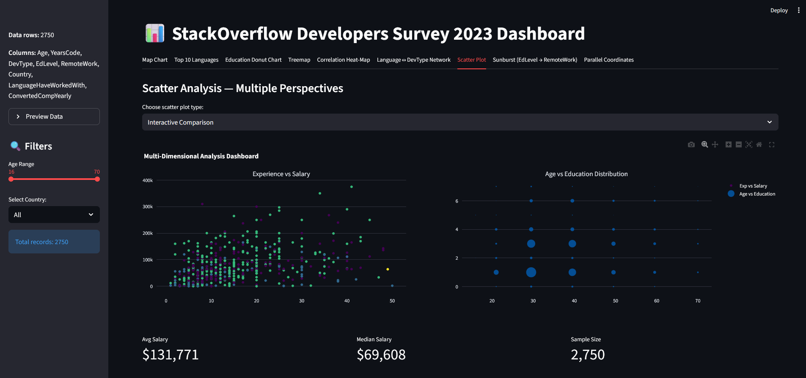

# StackOverflow Developer Survey 2023 — Streamlit Dashboard

<p align="center">
    
</p>

_Figure: Streamlit dashboard overview page 1 of 12_

<hr>
A Streamlit dashboard for exploring the StackOverflow Developer Survey 2023 data. The project provides multiple interactive Plotly visualizations (map, treemap, sunburst, parallel coordinates, scatter plots, network graph and more) to analyze developer demographics, tech stacks and compensation.

## Features
- Interactive Streamlit app (`app.py`) with tabs for multiple plots
- Plotly-based visualizations (choropleth, treemap, sunburst, parallel coordinates, scatter, network)
- Data cleaning and preprocessing in `data_processing.py`
- Handles multi-select fields such as `DevType` and `LanguageHaveWorkedWith`

## Requirements

- Python 3.12+ (recommended)

## Setup (Windows PowerShell)

1. Create & activate a virtual environment

```powershell
python -m venv .venv
.\.venv\Scripts\Activate.ps1
```

2. Install dependencies

```powershell
pip install -r requirements.txt
```

## Run the app

Start the Streamlit app with:

```powershell
streamlit run app.py
```

Open the provided local URL (usually `http://localhost:8501`) in your browser.

## Files in this repository

- `app.py` — Streamlit application that loads the cleaned data and renders the visualizations.
- `data_processing.py` — Functions for reading `survey_results_public.csv` and cleaning/parsing fields (age parsing, years of experience conversion, splitting multi-select values).
- `plots.py` — Collection of plotting helper functions (Plotly + NetworkX) used by the app.
- `survey_results_public.csv` — Raw CSV data (StackOverflow survey data). Keep this file in the project root so `get_clean_data()` can load it.
- `requirements.txt` — Pinned Python dependencies.

## Data notes

- `get_clean_data()` (in `data_processing.py`) reads `survey_results_public.csv` and performs basic cleaning and conversions. It converts age ranges to numeric approximations, parses multi-select semicolon-separated fields into lists, and coerces numeric columns where possible.
- Large outliers are filtered inside some plotting functions (for example salary caps) to improve visualization clarity.
